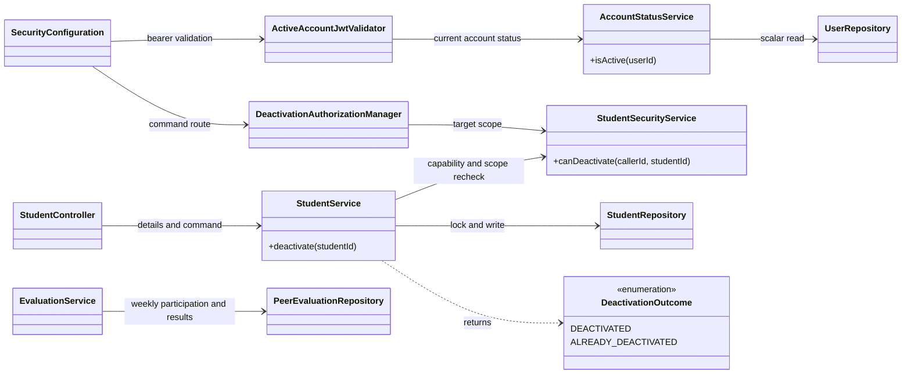
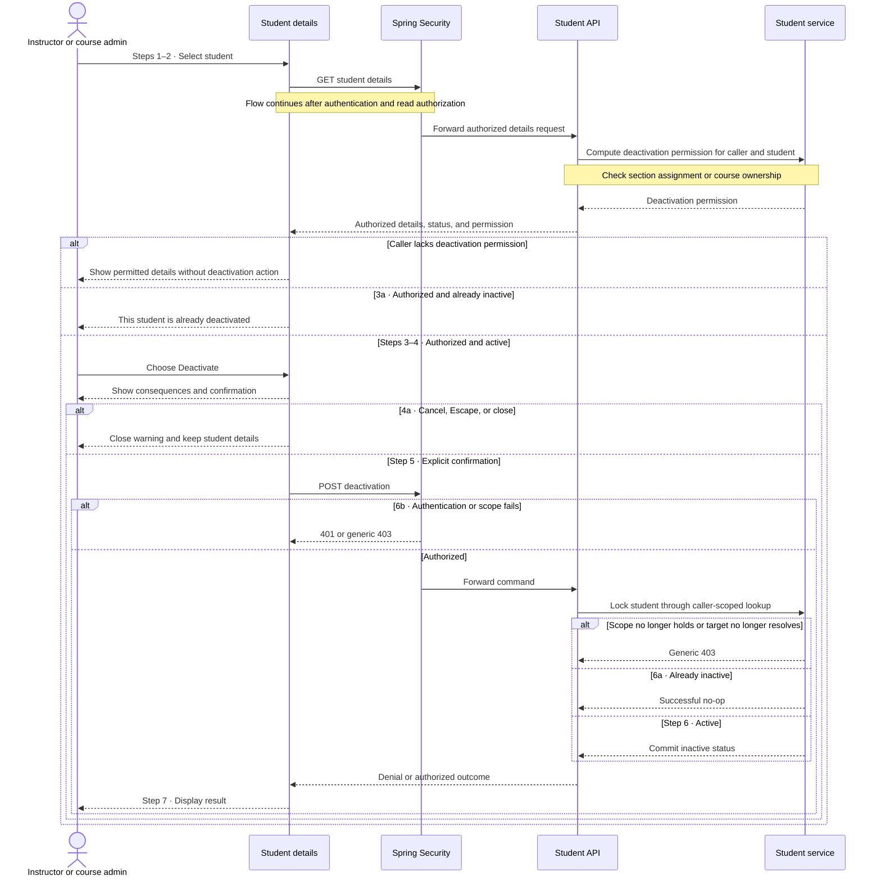

# Student Design

> Realizes [UC-STU-deactivate-student](../requirements/use-cases.md#uc-stu-deactivate-student-the-course-admininstructor-deactivates-a-student) and integrates with UC-EVA-submit-evaluation and UC-EVA-section-evaluation-report.
> Depends on [FR-SEC-authentication, FR-SEC-authorization, FR-SEC-deny-unauthorized, and FR-SEC-active-account](../requirements/software-requirements-specification.md#security-and-authorization-requirements).
> See the [Container Diagram](architectural-design.md#containers), [Crosscutting Concepts](architectural-design.md#crosscutting-concepts), and [Business Domain Model](../requirements/software-requirements-specification.md#business-domain-model).

## Overview

The student details view sends a dedicated deactivation command through the existing API and security filter chain. The student service changes the existing account flag. The evaluation slice owns submission and reporting, and the notification slice already derives submission obligations from current account status. [SubmissionStatusService](../../backend/src/main/java/team/projectpulse/notification/SubmissionStatusService.java)

## Components and classes

- **Student details and editing.** Extend the [roster](../../frontend/src/pages/students/Students.vue), [student details](../../frontend/src/pages/students/StudentPerformanceDashboard.vue), [staff edit form](../../frontend/src/pages/students/EditStudentForm.vue), and [student API module](../../frontend/src/apis/student/index.ts). Keep confirmation state in the details view. Reuse the existing [request client](../../frontend/src/utils/request.ts) and its error handling. Refresh the displayed status on either successful command outcome.
- **Student command and scope.** Extend [StudentController](../../backend/src/main/java/team/projectpulse/student/StudentController.java), [StudentService](../../backend/src/main/java/team/projectpulse/student/StudentService.java), [StudentRepository](../../backend/src/main/java/team/projectpulse/student/StudentRepository.java), and [StudentSecurityService](../../backend/src/main/java/team/projectpulse/student/StudentSecurityService.java). Add a deactivation authorization manager and a two-value command outcome. Compute the details capability and authorize the command with the same scope predicate. The existing self-service edit permission is insufficient for deactivation.
- **Shared bearer authentication.** Register a new `ActiveAccountJwtValidator` in [SecurityConfiguration](../../backend/src/main/java/team/projectpulse/security/SecurityConfiguration.java). Keep ordinary JWT validation. After it passes, the validator passes the validated user ID to `AccountStatusService`, whose public read-only transactional method makes a scalar lookup through [UserRepository](../../backend/src/main/java/team/projectpulse/user/UserRepository.java). Missing or disabled accounts fail bearer authentication. The lookup transaction finishes before route authorization and the controller transaction. It needs neither an authenticated principal nor a password encoder. A dependency through [UserService](../../backend/src/main/java/team/projectpulse/user/UserService.java) could lead back to the configuration that provides its password encoder.
- **Peer evaluation.** Reconcile saved evaluations and the current roster by evaluatee in the [submission view](../../frontend/src/pages/evaluations/SubmitTeamsEvaluations.vue). Require active rows and offer inactive rows as optional. Choose create or update per row so an optional evaluation can be added after required rows are saved. Retain the existing server eligibility, ownership, and window checks. Extend [EvaluationService](../../backend/src/main/java/team/projectpulse/evaluation/EvaluationService.java), [PeerEvaluationRepository](../../backend/src/main/java/team/projectpulse/evaluation/PeerEvaluationRepository.java), and the [section report view](../../frontend/src/pages/evaluations/admin/SectionsEvaluations.vue) for weekly participation and the inactive author-only display.

## Deactivation flow

### Confirmation copy

**Deactivate [student name]?**

> Once deactivation takes effect, further requests for protected resources will be denied even if the student is already signed in. She will no longer be able to log in, submit weekly activity reports or peer evaluations, or receive submission reminders.
>
> Her account, team assignment, and previously submitted work will be kept. Teammates will no longer be required to evaluate her, but eligible teammates may still submit or edit optional evaluations about her while the submission window is open. Her account can be reactivated later.

**Cancel** and **Deactivate student**. Confirm is disabled while the command is in flight. Dismissing the warning before confirmation closes it locally and keeps the selected details view open.

## API contract

All paths use the existing API prefix and response envelope.

| Method and path | Caller and input | Success and errors |
| --- | --- | --- |
| New `POST /students/{studentId}/deactivation` | Assigned instructor or owning course admin. Student ID in path. No body. | `200` with an outcome of `DEACTIVATED` or `ALREADY_DEACTIVATED`. `401` without valid authentication. Generic `403` for failed scope or unresolved student ID, with no target details. |
| Changed `GET /students/{studentId}` | Existing authorized readers plus owning course admins. Student ID in path. | `200` with student details, existing `enabled` status, and caller-specific `canDeactivate` permission. Existing authentication and scope denials apply. |
| Changed `POST /students/search` | Existing roster callers. Existing filters and paging, including the selected section. | `200` with the scoped roster. Validate the selected section against assignment or course ownership on the server. Keep the existing default when the section filter is omitted. `401` for invalid authentication and `403` for a section outside scope. |
| Changed `PUT /students/{studentId}` | Existing authorized profile callers. Profile fields and optional explicit re-enable intent. | `200` with updated profile. Ignore copied `enabled` values for writes. Failed lifecycle scope on explicit re-enable gets generic `403`. Existing profile validation and authentication errors apply. |
| Changed `GET /evaluations/sections/{sectionId}/week/{week}` | Existing authorized section-report callers. Section ID and week in path. | `200` with report rows and a null `averageTotalScore` for inactive author-only rows. Existing errors and access scope apply. |

The submission view uses the existing `POST /evaluations` and `PUT /evaluations/{evaluationId}` contracts per row. The scheduled and on-demand reminder paths keep their existing contract.

## Decisions

- **One account transition.** In the command transaction, use a caller-scoped student lookup with a write lock. Evaluate current section assignment or course ownership in that lookup. A scope change committed before the lookup takes effect for that command. The lookup establishes authorization before the service reads status. A missing or out-of-scope result uses the same generic `403` as the route. Concurrent confirmations serialize and a repeated authorized request succeeds with a distinct no-op outcome. A conflict response would make a retry after a lost response appear to fail. Retain the team assignment and work, as specified by BR-student-lifecycle. BR-submission-owed already handles reminder eligibility and required evaluatees.
- **Keep the existing staff re-enable control.** Both the command and profile save read the status-bearing row under the same locking discipline. The staff edit form sends `reenable` only on an explicit Enable choice made on an inactive account. The self-service [UserInfo view](../../frontend/src/pages/currentUser/UserInfo.vue) sends an ordinary profile update. Blocking only `enabled: false` would still let a stale profile form re-enable an account via `enabled: true`. The intent preserves the existing staff capability on the same endpoint. The separate reactivation use-case workflow is outside this build.
- **Preserve the selected-week boundary.** Active students retain the current report inclusion behavior. A currently team-assigned active student appears even without evaluations. An active student without a team stays excluded. This is an existing-code regression baseline, separate from BR-submission-owed. For inactive students in the selected section, use a batched selected-week query that considers both evaluator and evaluatee IDs. A current-status-only filter would hide historical rows. Compute grades and comments from received work, and show "No evaluations received" for an inactive author-only row. The authored work contributes to the recipient's results under the existing privacy rules.
- **Check server-side account status on bearer requests.** A lookup starting after deactivation commits reads the disabled flag. An already-authenticated request may finish under its existing authorization. The existing HTTP Basic login path checks `MyUserPrincipal.isEnabled()` and is covered by the disabled-login regression test. Caching account status could leave a grace period. Permanently revoking previously issued tokens would change the approved reactivation behavior. The existing client may clear its local token after a `401`. A still-held and otherwise-valid token can be accepted again after reactivation.
- **Keep navigation independent of performance panels.** Pass the selected section from the existing section context into the roster without overwriting global default-section settings. Load the student header and action independently of WAR and evaluation panels. For these embedded panel requests only, use the shared request client with local handling of `403` and `404` so those responses can be displayed in the panel. Continue to use the global `401` handling.
- **Keep profile and evaluation retries explicit.** Rejecting a staff re-enable intent rolls back the whole profile update. A deliberate Enable applies to the current locked row and the client does not automatically retry it after a lost response. For evaluation saves, retain successful rows and their IDs after a partial failure. Reload the week's saved rows before retrying a write with an unknown outcome. On retry, update existing rows by ID and create only missing intended rows. Blank optional rows are skipped and do not affect completion under BR-submission-owed.

## Data model and architecture

Reuse `PeerEvaluationUser.enabled`, the student's existing section and team links, and the evaluator and evaluatee relationships. There are no schema changes. The live account gate stays within the existing shared security and identity components. See the [Level-1 authentication view](architectural-design.md#authentication).

## Tests

| Flow | Level | Oracle and checks |
| --- | --- | --- |
| Main flow and retained work | Browser and API integration | Steps 1–7 and BR-student-lifecycle. An assigned instructor and an owning admin without section assignment reach the student through the normal UI and can confirm. Check the rendered title, selected student name, exact warning paragraphs above, and both buttons. The warning alone sends zero commands. One explicit confirmation sends one command, including a rapid second click while pending. Status changes and team assignment, WARs, and evaluations are preserved. [Steps 1–7](../requirements/use-cases.md#uc-stu-deactivate-student-the-course-admininstructor-deactivates-a-student) · [Lifecycle rule](../requirements/business-rules.md#course-administration) |
| Owning admin with a panel error | Browser integration | Steps 2–5 and BR-section-scoped-access. A legacy panel receiving `403` or `404` stays local to that panel. The owning admin retains the selected details and can confirm deactivation. [Details and confirmation](../requirements/use-cases.md#uc-stu-deactivate-student-the-course-admininstructor-deactivates-a-student) · [Section scope](../requirements/business-rules.md#access-and-ownership) |
| Already inactive at selection | Browser and API integration | Extension 3a. Only a caller with deactivation permission sees "This student is already deactivated." A permitted details reader without that permission sees no lifecycle action or outcome. Selection sends zero commands. [Extension 3a](../requirements/use-cases.md#uc-stu-deactivate-student-the-course-admininstructor-deactivates-a-student) |
| Already inactive at confirmation | Browser and API integration | Extension 6a. Complete a second authorized request after another actor deactivates the student while confirmation is open. Expect the exact message and no further changes. Concurrent confirmations produce a single transition. [Extension 6a](../requirements/use-cases.md#uc-stu-deactivate-student-the-course-admininstructor-deactivates-a-student) |
| Cancel and dismiss | Browser integration | Extension 4a. Exercise Cancel, Escape, close, and any other enabled dismissal separately. Intercept the command route and assert **zero requests** in every case, with the warning closed and the same student details and status visible. [Extension 4a](../requirements/use-cases.md#uc-stu-deactivate-student-the-course-admininstructor-deactivates-a-student) |
| Denial and precedence | API integration | Extension 6b and BR-section-scoped-access. Student self, an unassigned instructor, an unrelated admin, and an unresolved student ID get generic `403`; active and inactive targets have the same denial with no target details or mutation. A caller who loses scope after opening details gets the same denial. Missing or invalid authentication gets `401`. [Extension 6b](../requirements/use-cases.md#uc-stu-deactivate-student-the-course-admininstructor-deactivates-a-student) · [Section scope](../requirements/business-rules.md#access-and-ownership) |
| Existing JWT while inactive | Full-context API integration | FR-SEC-active-account and deactivation Associated Information. Use a real issued token successfully before deactivation. The same unexpired token receives `401` on protected read and write requests after deactivation. The denied write has no effect. New login is denied while inactive. Exercise the first commit with a persisted fixture change, then repeat with the actual command. Include the shared inactive-instructor case and verify missing accounts fail bearer authentication. [Active-account FR](../requirements/software-requirements-specification.md#security-and-authorization-requirements) · [Deactivation note](../requirements/use-cases.md#uc-stu-deactivate-student-the-course-admininstructor-deactivates-a-student) |
| Existing JWT after re-enable | API integration | Reactivation Associated Information. Restore status through the existing staff edit path and prove the same otherwise-valid unexpired token can access a permitted resource again. [Reactivation note](../requirements/use-cases.md#uc-stu-reactivate-student-the-course-admininstructor-reactivates-a-student) |
| Profile update compatibility | Browser and API integration | UC-ACC-edit-account step 10, deactivation steps 4–6, and BR-student-lifecycle. Both existing callers can edit profile fields. A copied false value cannot deactivate, a stale true value cannot re-enable, an authorized explicit Enable works, and an out-of-scope Enable is denied. A competing profile write preserves the committed inactive status. [Account-edit flow](../requirements/use-cases.md#uc-acc-edit-account-the-student-edits-an-account) · [Deactivation flow](../requirements/use-cases.md#uc-stu-deactivate-student-the-course-admininstructor-deactivates-a-student) |
| Owed items and optional evaluations | Browser and API integration | BR-submission-owed and BR-evaluation-inactive-teammate, UC-EVA-submit-evaluation steps 2–9 and extension 1b. The inactive student owes nothing and her teammates can finish the required submissions without rating her. An eligible teammate can later create and edit an optional evaluation during the window. Both writes are refused after close. [Submission rules](../requirements/business-rules.md#weekly-activity-report-and-peer-evaluation) · [Submission use case](../requirements/use-cases.md#uc-eva-submit-evaluation-the-student-submits-a-peer-evaluation-for-the-previous-week) |
| Partial evaluation save and retry | Browser integration | UC-EVA-submit-evaluation steps 7–9 and BR-submission-owed. After a partial failure, reload or reconcile saved rows before retrying. Successful rows retain their IDs, retry creates only missing intended rows, and blank optional rows are skipped. [Submission use case](../requirements/use-cases.md#uc-eva-submit-evaluation-the-student-submits-a-peer-evaluation-for-the-previous-week) · [Submission rules](../requirements/business-rules.md#weekly-activity-report-and-peer-evaluation) |
| Inactive report rows and privacy | API and browser integration | BR-evaluation-inactive-teammate, BR-evaluation-visibility, BR-evaluation-private-comment, and UC-EVA-section-evaluation-report step 5. Include inactive author-only, recipient-only, and both cases for the week. Exclude a student with neither. Author-only has no grade. Recipient scores and comments remain received-only and obey access restrictions. [Evaluation rules](../requirements/business-rules.md#weekly-activity-report-and-peer-evaluation) · [Section report](../requirements/use-cases.md#uc-eva-section-evaluation-report-the-instructor-generates-a-peer-evaluation-report-of-the-entire-course-section) |
| Evaluations in another week | API integration | BR-evaluation-inactive-teammate and the selected-week report parameter. An inactive author-only student and a separate inactive recipient-only student have saved activity in week 8 and neither has an evaluation in week 9. Both appear in week 8 and neither appears in week 9. [Evaluation rules](../requirements/business-rules.md#weekly-activity-report-and-peer-evaluation) · [Section report's week parameter](../requirements/use-cases.md#uc-eva-section-evaluation-report-the-instructor-generates-a-peer-evaluation-report-of-the-entire-course-section) |
| Active report rows | API integration, existing-code regression | Active team-assigned students appear even without evaluations for the week. Active teamless students stay excluded. The report specifies a section and week, and BR-submission-owed governs the separate owed list. The grade-row assertion comes from [the existing roster filter](../../backend/src/main/java/team/projectpulse/evaluation/EvaluationService.java#L223), checked against the [section report](../requirements/use-cases.md#uc-eva-section-evaluation-report-the-instructor-generates-a-peer-evaluation-report-of-the-entire-course-section). |
| Report performance | Planned load check | Inspect account lookup and participation query counts. Measure report-view p95 with account validation enabled at the SCA-cohort-load concurrency envelope against the PER-report-load 500 ms target. No performance measurement is available at design time. [Quality attributes](../requirements/software-requirements-specification.md#quality-attributes) |

## Implementation review order

Commit the shared bearer account gate and its full-context integration tests first. The tests obtain real tokens and change the fixture through persistence so this commit can be reviewed independently of the new command. Pause at this commit for review. Keep the dedicated command matcher and its scope tests in a separately reviewable security-rule commit, following [the implementation workflow](../../.claude/commands/implement.md#phase-3--implement).
